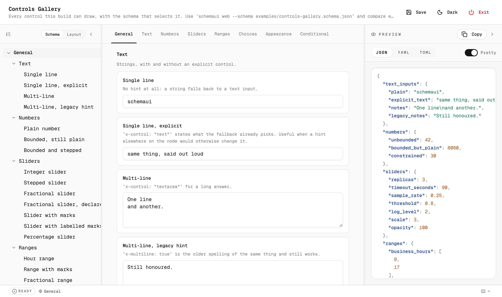
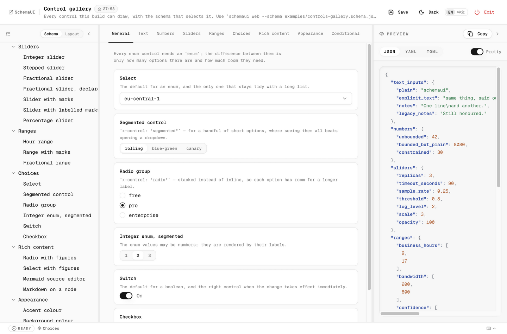
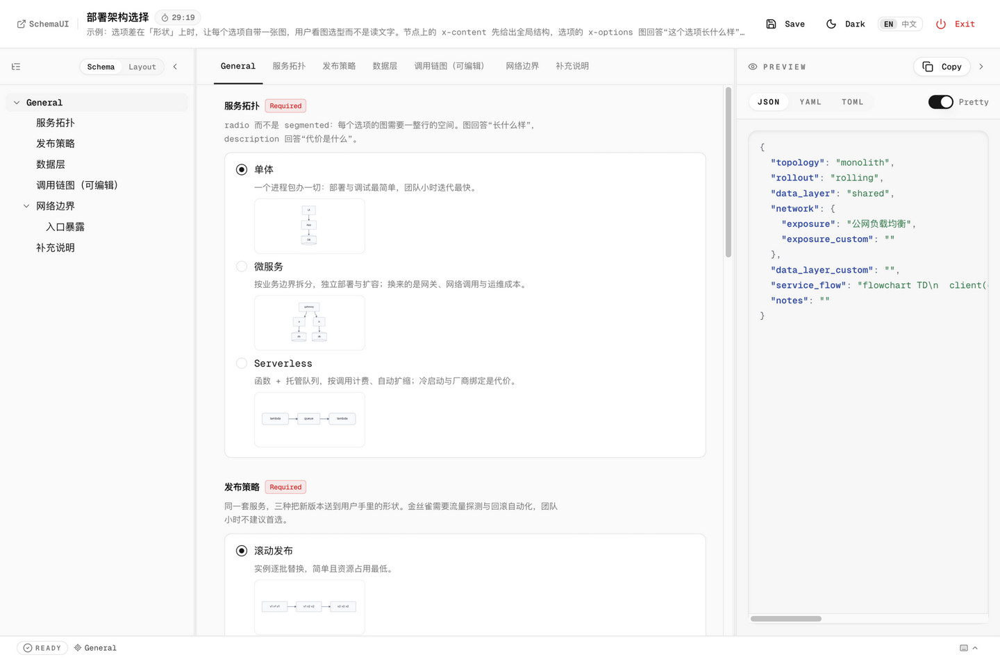
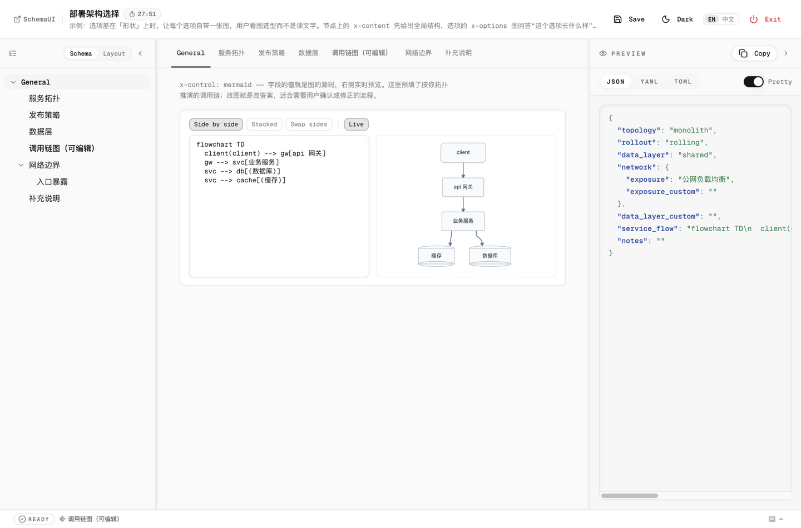

# a2ui-ask

> **给 AI agent 一个真正的界面 —— 把结构化问题变成浏览器表单。**

当 Claude Code、Codex、Cursor 或任何 agent 需要你选选项、填结构化配置
时，`a2ui-ask` 会弹出一张**真正的浏览器表单**——带校验、带默认值、带多
选——而不是刷屏的纯文本提问。你的答案会落盘成带时间戳的 JSON 文件，你 和 agent
之后都能随时回顾。

[English](./README.md) | [中文文档](./README.ZH.md)



引擎能画的所有控件——滑块、带刻度的范围滑块、分段控件、单选组、开关、
自定义取色器、条件字段——全部由 schema 提示驱动，skill 也会明确要求 agent 主动
用起来。图形走同一套提示：问题和选项都可以带 **Mermaid 图、内联 SVG 或 Markdown
说明**（`x-content` / `x-options`），答案本身也可以是一张可编辑的
实时预览图（`x-control: "mermaid"`）。完整清单见
[`schemaui` 控件画廊](https://github.com/YuniqueUnic/schemaui/blob/main/examples/controls-gallery.schema.json)
与
[富内容画廊](https://github.com/YuniqueUnic/schemaui/blob/main/examples/rich-content.schema.json)；
[`examples/web-research-brief.schema.json`](./examples/web-research-brief.schema.json)
是把这些控件全部用上的一份中文范例。

<table>
  <tr>
    <td></td>
  </tr>
  <tr>
    <td></td>
  </tr>
  <tr>
    <td></td>
  </tr>
</table>

## 为什么需要它

Agent 的工具调用跑在**没有 TTY** 的子进程里——终端提示符根本渲染不出 来，agent
会卡在一个没人看得到的问题上干等。而聊天里喊出来的答案，刷过去
就没了，无法审计。

`a2ui-ask` 两个问题一起解决：

1. **用浏览器表单，不用终端。** Agent 在本地拉起一个 Web UI(以
   [schemaui](https://github.com/YuniqueUnic/schemaui) 为引擎),绑定
   `0.0.0.0`,桌面、手机、SSH 隧道、IDE 端口转发都能访问。
2. **答案写文件，不只打 stdout。** 答案持久化到
   `.schemaui/answers/<主题>-<时间戳>.json`——每个决策都有审计轨迹。

```text
Agent 进程                      你的浏览器 (任何设备)
┌──────────────┐               ┌──────────────────┐
│ 生成 schema  │  1. 拉起      │  桌面 / 手机     │
│              │─────────────► │  (局域网可达)    │
│              │  ask.py       │                  │
│ 2. 在聊天里  │               │  http://<ip>     │
│ 告诉你 URL   │──────────────►│  :8787           │
│              │               │                  │
│              │  3. 你填表    │  实时校验        │
│ 4. 读答案    │◄──────────────│  Save & Exit     │
│   文件       │  JSON 落盘    │                  │
│ 5. 继续干活  │               │                  │
└──────────────┘               └──────────────────┘
```

## 安装

前置条件：`schemaui` 二进制（表单引擎，
[YuniqueUnic/schemaui](https://github.com/YuniqueUnic/schemaui))。自动安装脚
本会检测平台并下载预编译二进制：

```bash
bash scripts/install.sh      # macOS / Linux / FreeBSD
pwsh scripts/install.ps1     # Windows / PowerShell 7+
```

脚本优先从 GitHub 下载，**在国内访问不了 github.com 时自动回退到
[Gitee 镜像](https://gitee.com/Credhat/schemaui)**（tag 与文件名跟 GitHub 保持一
致）。也可以用 `--source github|gitee`（sh）/ `-Source github|gitee`（ps1）强制
指定来源：

```bash
bash scripts/install.sh --source gitee
```

其它渠道（brew、scoop、winget、cargo、手动下载）见
[`install.md`](./install.md)。注意 brew / scoop / winget 的清单里写死了 GitHub
下载地址，国内访问不了时请改用上面的 `--source gitee`，或 `cargo install`。

然后三选一安装 skill:

**方式一：一行安装 (推荐，走 [skills.sh](https://skills.sh))**

```bash
npx skills add YuniqueUnic/a2ui-ask
```

**方式二：让 AI 自己装**

对任意 Agent(Claude Code / Codex / Cursor 等) 说一句：

> 请帮我查找并自动安装 https://github.com/YuniqueUnic/a2ui-ask 这个 skill,clone
> 到对应的 skills 目录并接入。

**方式三：手动 clone**

```bash
# 全局(所有项目可用)
git clone https://github.com/YuniqueUnic/a2ui-ask.git ~/.claude/skills/a2ui-ask
# 或按项目安装
git clone https://github.com/YuniqueUnic/a2ui-ask.git .claude/skills/a2ui-ask
```

**方式四：npm**

[npm 包](https://www.npmjs.com/package/a2ui-ask)里是同一套 skill
文件。全局安装后链接进 skills 目录，之后 `npm update -g a2ui-ask` 就能原地升级：

```bash
npm install -g a2ui-ask
mkdir -p ~/.claude/skills
ln -s "$(npm root -g)/a2ui-ask" ~/.claude/skills/a2ui-ask
```

Codex / zcode 用户：把 [`prompts/ask.prompt.md`](./prompts/ask.prompt.md)
里现成的约定块粘贴到你的 `AGENTS.md`。

## 5 分钟快速上手

在 skill 目录里 (clone 下来的仓库或 npm 包均可)、且 `schemaui` 已在 PATH 上：

```bash
python3 scripts/ask.py \
  --schema examples/env-schema.json \
  --config examples/env-defaults.json \
  --title "部署配置确认"
```

1. 脚本打印 `SCHEMAUI_URL=http://127.0.0.1:8787/` 并自动打开浏览器。
2. 你在表单里改 (实时校验),点 **Save & Exit**。
3. 答案 JSON 打印到 stdout，同时持久化到 `.schemaui/answers/`。

这就是完整闭环。之后 agent 每次需要做决策都会跑同一条命令——你看到的
是表单，而不是连环追问。

Windows / PowerShell 7+:`pwsh scripts/ask.ps1 -Schema … -Title …`。没有 Python
的 macOS/Linux:`bash scripts/ask.sh --schema …`。

## Agent 会怎么用它

- 一组相关的决定只开一张表单，推荐答案已经预填，文字用你的语言。
- 按答案挑控件：滑块、双柄范围、取色器、分段和单选、复选框、条件字段、记录列表、
  键值映射。
- 选项差在「形状」上时给每个选项配一张图；答案本身是图时，给你一个可编辑的图。
- 每个选择都留「其他」和补充框，你不会被迫选错。
- 表单跑不起来就改用文字提问，不会卡住任务。

给 agent 的规则在 [`SKILL.md`](./SKILL.md)；控件目录在
[`references/controls.md`](./references/controls.md)；脚本契约、原生命令和主题在
[`references/engine.md`](./references/engine.md)。

## 示例

[`examples/`](./examples/) 里可直接运行的表单 (每个都带 `.defaults.json`
推荐答案):

| 示例                                                                                    | 场景                                                |
| --------------------------------------------------------------------------------------- | --------------------------------------------------- |
| [`env-schema.json`](./examples/env-schema.json)                                         | 最小 4 字段部署表单 —— 首次冒烟测试                 |
| [`web-research-brief.schema.json`](./examples/web-research-brief.schema.json)           | 调研：联网调研任务确认 —— 用上画廊全部控件 (中文)   |
| [`feature-brief.schema.json`](./examples/feature-brief.schema.json)                     | 12 问需求简报，覆盖全部控件类型 (英文)              |
| [`invoice-reimbursement.schema.json`](./examples/invoice-reimbursement.schema.json)     | 办公：发票报销处理 (中文，每个选择带「其他」逃生口) |
| [`ecommerce-main-image.schema.json`](./examples/ecommerce-main-image.schema.json)       | 设计：电商主图 —— 尺寸、字号、颜色、渐变背景 (中文) |
| [`seo-diagnosis.schema.json`](./examples/seo-diagnosis.schema.json)                     | SEO 排查：站点、问题、关键词、竞品 (中文)           |
| [`deployment-architecture.schema.json`](./examples/deployment-architecture.schema.json) | 架构选型：每个选项自带一张图 (中文，图形界面参考例) |

## 开发

```bash
# 单测 + e2e(e2e 直接驱动真实 schemaui 的 HTTP API,不需要浏览器)
SCHEMAUI_BIN=$(command -v schemaui) python3 -m pytest tests/
# pwsh 在 PATH 上(或设置 PWSH_BIN)时会自动加跑 PowerShell e2e
```

## 链接

- [npm 包](https://www.npmjs.com/package/a2ui-ask)
- [linux.do](https://linux.do)

## 许可证

MIT —— 见 [LICENSE](./LICENSE)。
